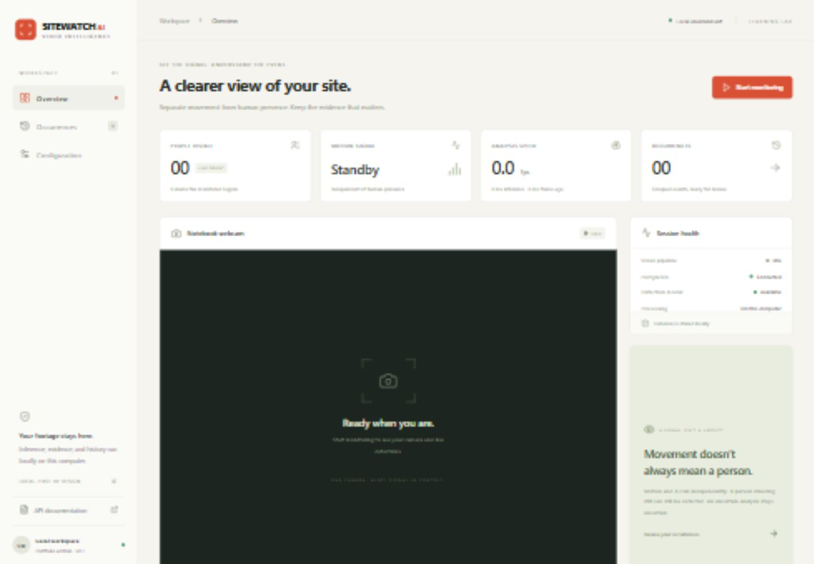

# SiteWatch AI

**Understand what triggered the alarm.**

A local video analytics application that compares conventional motion detection with AI-based human presence detection. It groups activity into occurrences, keeps visual evidence, and provides a separate human-review audit trail.

Built as an open-source learning and portfolio project, with concepts intended for a future remote monitoring service.



## What it does

- Captures one notebook webcam and displays an annotated live view.
- Runs motion analysis and human detection independently, including people standing still.
- Supports a rectangular monitoring region with normalized coordinates.
- Groups observations into occurrences instead of generating an alert for every frame.
- Stores sessions, observations, evidence metadata, and reviews in PostgreSQL.
- Saves representative original and annotated JPEGs locally.
- Distinguishes **person detected**, **no person detected**, and **inconclusive**.
- Keeps the automatic classification when a reviewer adds their own conclusion.
- Reports unavailable cameras, interrupted analysis, and database/storage failures.

There is no facial recognition, identity database, cloud inference, or automatic determination of an intrusion. A model score is not a calibrated probability. A negative detection is not proof that an alarm is false.

## Stack

Python 3.12 · FastAPI · Pydantic · OpenCV · Ultralytics YOLO26n / PyTorch CPU · PostgreSQL 16 · SQLAlchemy · Alembic · React · TypeScript · Vite

The application runs on the host to access the webcam. The database is an existing, native PostgreSQL installation. The API and built frontend bind to `127.0.0.1:8000`.

## Quick start — Windows / PowerShell

Prerequisites: Python **3.12**, Node.js **22.12+ or 24**, PostgreSQL **16+**, and a webcam. Installations and the initial official model download require internet access; monitoring does not require a cloud inference account.

```powershell
git clone https://github.com/ProgrammerGV/sitewatch-ai.git
cd sitewatch-ai
py -3.12 -m venv .venv
.venv\Scripts\python.exe -m pip install -r requirements.lock
.venv\Scripts\python.exe -m pip install -e . --no-deps
Copy-Item .env.example .env
```

Create a dedicated PostgreSQL role and database using an administrative `psql` session:

```sql
CREATE ROLE sitewatch LOGIN;
\password sitewatch
CREATE DATABASE sitewatch OWNER sitewatch;
```

Set `DATABASE_URL` in `.env` to your own credentials and port. URL-encode special characters in the password. Never commit this file.

```powershell
.venv\Scripts\sitewatch.exe migrate
.venv\Scripts\sitewatch.exe download-model
Push-Location frontend
npm ci
npm run build
Pop-Location
.venv\Scripts\sitewatch.exe serve
```

Open **http://127.0.0.1:8000**. API documentation is at **http://127.0.0.1:8000/docs**. Start monitoring from the dashboard; camera capture is opt-in and stops with the monitoring control.

If `py` is unavailable, use the full path to a Python 3.12 executable for the first command. A Python 3.14 installation cannot use this project's Python 3.12 environment.

### First session

1. Close other applications using the webcam and click **Start monitoring**.
2. Allow the motion background model to adapt for five seconds. Human detection is already active.
3. Move an object, enter the image, and then stand still. Compare the separate indicators.
4. Stop monitoring. In **Configuration**, drag a rectangle over the last captured scene and save it.
5. Start another session. Open an occurrence after it closes and record a review.

Stopping an active occurrence marks it interrupted; previously confirmed human presence remains recorded. An interrupted negative analysis stays inconclusive.

## Development and tests

Backend: `.venv\Scripts\sitewatch.exe serve`

Frontend, in a second terminal:

```powershell
cd frontend
npm run dev
```

Use http://127.0.0.1:5173. Vite proxies `/api` and `/health` to the backend. Use only one backend process; disable multiple workers and automatic process reload while monitoring.

Unit tests run without PostgreSQL or a webcam:

```powershell
.venv\Scripts\python.exe -m pytest -q -m "not integration"
```

For integration tests, create an isolated database whose name ends in `_test`, owned by your test role. Set `TEST_DATABASE_URL` to its SQLAlchemy connection URL. Tests create and remove only their own randomly named schemas.

```powershell
.venv\Scripts\python.exe -m pytest -q
.venv\Scripts\python.exe -m ruff check backend tests
```

The suite covers stationary presence, motion-only occurrences, region boundaries, grouping, inadequate analysis, failure recovery, evidence, reviews, API validation, and the single-instance guard. GitHub Actions runs the backend tests with a PostgreSQL service and builds the frontend.

### Repeatable video analysis

```powershell
.venv\Scripts\sitewatch.exe replay C:\videos\scenario.avi --seconds 40
```

This uses the real detector and persistence pipeline, with video playback paced in real time. Stop the server first, or use a separate `DATA_DIR` **and a separate database**. Recorded-video input is a CLI tool for experiments, not a dashboard upload feature.

## Architecture and learning path

```text
Webcam → latest-frame capture ┬→ motion analysis ─┐
                             └→ person detector ┴→ rules → occurrences
                                                            ├→ PostgreSQL
                                                            ├→ local JPEG evidence
                                                            └→ FastAPI → React dashboard
```

The latest-frame slot stays bounded. Inference, camera capture, API calls, and database persistence have distinct responsibilities. Detection results are converted to application data before business rules are applied.

- [Architecture and database model](docs/ARCHITECTURE.md)
- [Learning guide](docs/LEARNING.md)
- [Validation results and limitations](docs/VALIDATION.md)
- [Security and development dependency notes](SECURITY.md)
- [Contribution and commit conventions](CONTRIBUTING.md)

## Roadmap

- Add RTSP and vendor-specific event connectors behind the capture boundary.
- Evaluate recall and false alarms using labeled, representative security-camera footage.
- Introduce event-driven cloud ingestion and storage, then integrate with SIMIP.
- Add authentication, tenant isolation, retention policies, and operational monitoring before remote deployment.

## License

AGPL-3.0-only. See [LICENSE](LICENSE). Dependencies retain their own licenses. The model is downloaded from the official Ultralytics assets repository and is not redistributed here. Review licensing separately before reusing this project inside a proprietary commercial service.

Private footage, model weights, database credentials, and runtime data are excluded from version control. The screenshots in this repository show the interface without personal footage.
