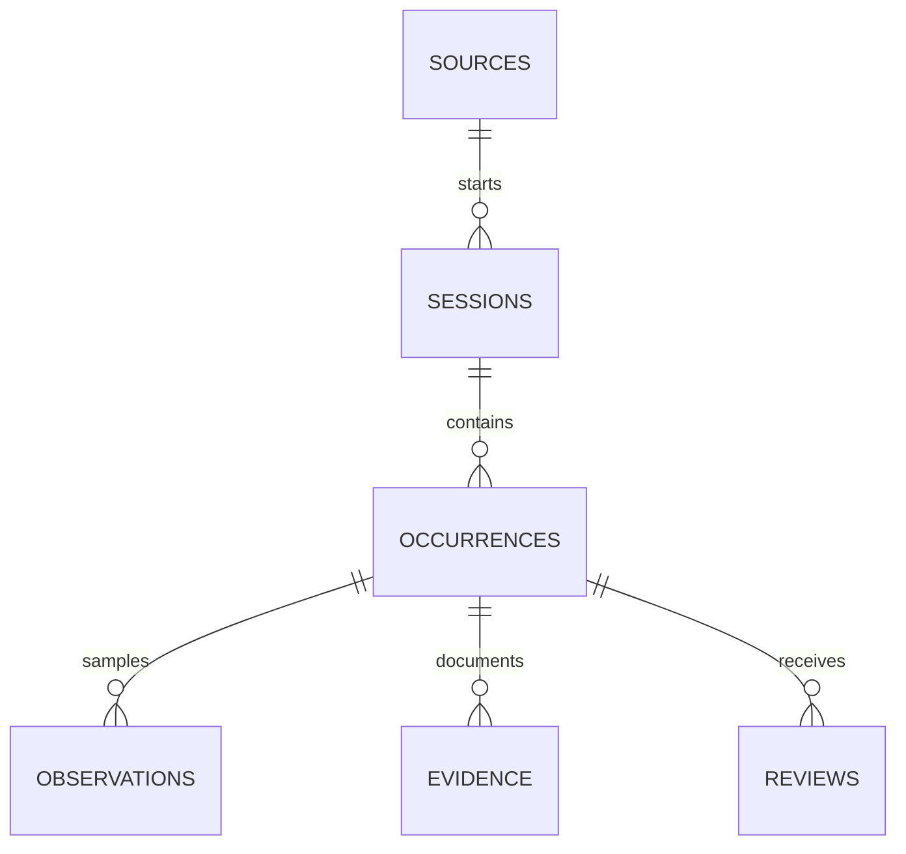

# Architecture

## Boundaries

SiteWatch is a modular application with one backend process. A dedicated capture thread reads the camera; an analysis thread consumes the most recent frame. FastAPI handles control and history requests. The browser receives annotated JPEG frames over MJPEG and polls status once per second.

The first release deliberately supports one source, one active session, and one local user. A filesystem lock prevents a second backend from taking the same workspace. A different data directory does not make sharing the same database between independent instances safe.

| Module | Responsibility |
| --- | --- |
| `domain` | Pure geometry, confirmation, grouping, classification |
| `vision` | OpenCV motion, YOLO inference, annotation |
| `monitor` | Capture slot, worker lifecycle, pipeline orchestration |
| `storage` | Session/event persistence and evidence files |
| `database`, `models` | Transactions, mappings, startup reconciliation |
| `app`, `schemas` | HTTP interface, validation, local-access controls |
| React frontend | Monitoring, configuration, history, human review |

Model inference never runs inside a FastAPI request handler. The current worker is a thread; moving it to another process or server is a future deployment change, not a claim that the current application already supports distributed operation.

## Detection and occurrence lifecycle

The model returns normalized boxes and confidence scores. A bottom-center point inside or on the rectangular boundary qualifies as presence in the region. Boxes outside the region remain visible in gray.

Human presence requires two positive observations within two seconds. Motion also requires two positive observations within that window, after the five-second background warmup. Presence analysis is not gated by motion.

An occurrence opens on either confirmed signal. Repeated activity extends it; five seconds without qualifying activity closes it. Multiple people share that occurrence, and its peak count is a simultaneous count rather than a visitor count.

A negative classification requires at least three successful analyses and no analysis gap over two seconds. Errors and interruptions produce an inconclusive result unless human presence was already confirmed. Positive evidence survives interruptions. Review decisions are stored separately and never rewrite model output.

Motion-only evidence establishes that the conventional detector reacted without confirmed human presence. It does not prove which object caused the movement or guarantee that a person was absent.

## Database model

- **sources:** UUID, name, kind, camera index, normalized region, confidence and motion thresholds.
- **sessions:** source foreign key, UTC start/end, lifecycle, model filename and SHA-256, configuration snapshot, failure message.
- **occurrences:** session foreign key, lifecycle, UTC activity timestamps, automatic classification, peak people, analysis coverage summary.
- **observations:** occurrence foreign key, persistence timestamp, motion score, people in region, normalized model boxes and scores.
- **evidence:** occurrence foreign key, capture/persistence timestamp, original/annotated kind, relative file path.
- **reviews:** occurrence foreign key, independent decision, optional note, UTC creation time. Reviews are append-only in the API.

Observations are persisted at up to one per second, plus the first human-confirmation transition. The coverage summary counts all successful analyses, so observation-row counts need not equal analysis counts. Observation timestamps are taken when persisted; this release does not provide forensic frame synchronization or hardware timestamps.

UUIDs identify application records. Serial numbers and future vendor identifiers should be separate source attributes, not substitutes for internal IDs. There is no `people` identity table.

## Evidence and failures

Each occurrence keeps up to two representative JPEGs: original and annotated. Evidence can be replaced by a higher-confidence in-region frame while the event is active. Temporary files are atomically renamed before metadata is committed. The filesystem and PostgreSQL are not a distributed transaction: a failure can leave an orphaned file, and the service reports the failure instead of silently accepting it.

The default evidence quota is 2 GiB, configurable with `MAX_EVIDENCE_MB`. Reaching it stops the session with an explicit error. Automatic retention and deletion are deferred. If files are archived externally, their old database references may no longer resolve; the evidence endpoint returns 404.

Camera disconnection, stale capture, detector exceptions, and database errors stop the worker. The API remains available for diagnostics. Sessions left open by a crashed process are reconciled as interrupted at the next startup. The camera does not restart automatically.

## HTTP interface

| Method and path | Purpose |
| --- | --- |
| `GET /api/source` | Read local source configuration |
| `PATCH /api/source` | Update while monitoring is stopped |
| `GET /api/monitor/status` | Lifecycle and live metrics |
| `POST /api/monitor/start` | Start once; repeated starts reuse the active session |
| `POST /api/monitor/stop` | Stop the worker and release capture |
| `GET /api/monitor/stream` | MJPEG annotated preview |
| `GET /api/occurrences` | Paginated results, optional classification filter |
| `GET /api/occurrences/{id}` | Evidence, reviews and up to 100 recent observations |
| `POST /api/occurrences/{id}/reviews` | Append review after the event closes |
| `GET /api/evidence/{id}` | Resolve evidence by UUID, constrained to its root |
| `GET /health/live`, `GET /health/ready` | Process and dependency diagnostics |

## Transfer to the company service

Capture becomes a camera/event connector. Inference becomes a separately deployed worker or provider adapter. PostgreSQL remains the relational history; evidence storage becomes an object-storage adapter. A versioned occurrence contract can feed SIMIP.

Before that transfer, validate camera firmware, network access, evidence availability, event volume, representative accuracy, permissions, costs, retention and outage handling. Multi-tenancy, queues, authenticated ingestion and delivery retries must be designed and tested rather than inferred from this local application.
